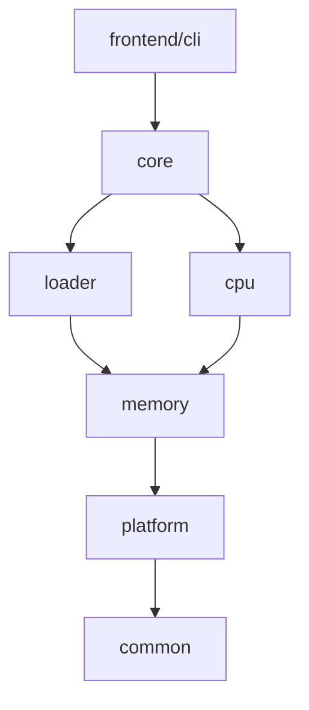

# Architecture overview

ZenithPS5 loads an x86-64 program into a *guest address space* inside its own process, runs it **natively** on
the host CPU, and answers its calls to the system with **host functions** (high-level emulation, HLE).

The PS5's CPU is x86-64, so there is no instruction translation to do for the CPU itself. The work is
elsewhere: loading the program's format, reimplementing the system libraries it calls, and (later) the GPU.
See [ADR 0001](../adr/0001-hle-instead-of-static-recompilation.md).

## Modules

| Module | Folder | Role |
|---|---|---|
| common | `src/common` | Base types, logging (per-channel levels), assertions, `Result<T>` |
| platform | `src/platform` | Host virtual memory (reserve, protect, release). Linux only for now |
| memory | `src/memory` | `AddressSpace`: the guest's memory map, identity-mapped on the host |
| loader | `src/loader` | ELF parsing and loading: segments, relocations, imports by name |
| cpu | `src/cpu` | Guest stack, calling guest code, host-function stubs, crash handler |
| core | `src/core` | Running a program: the test bridge, `ImportTable`, `runElf` |
| frontend | `src/frontend/cli` | The `zenith` command |

A module only depends on the modules it is built on, never the other way (the arrows show the dependencies,
the CMake targets enforce them, and it is what keeps each module testable on its own):

All OS-specific code lives in `src/platform/`. The rest of the project contains no `#ifdef` for an operating
system.

## What happens when you run `zenith program.elf`

1. The CLI installs the crash handler, then reads the file.
2. `ElfFile::parse` validates the headers, the segments and the dynamic section.
3. `runElf` creates an `AddressSpace` and installs two things in it: the test bridge (fixed addresses) and the
   `ImportTable` (stubs for imports).
4. `loadElf` maps the segments (at the base address chosen for position-independent programs), applies the
   relocations and binds every import by name through the `ImportTable`.
5. A `GuestStack` is mapped and `callGuest` jumps to the entry point on that stack.
6. The program runs natively. When it calls an import, the stub jumps to a host function. When it returns or
   calls `exit`, `runElf` returns its result.

## Guest memory map

Guest addresses are host addresses (see [ADR 0002](../adr/0002-identity-mapped-guest-memory.md)). Everything is
mapped in whole *guest pages* of 16 KiB.

| Address | What | Notes |
|---|---|---|
| `0x100000` | Test bridge stubs | Fixed contract, see `src/core/bridge.hpp` |
| `0x200000` | Import stubs | 32 bytes per stub, 512 stubs |
| `0x400000` | Default base of position-independent programs | Configurable; fixed-address programs go where they were linked |
| `0x3000'0000'0000` | Main guest stack | 1 MiB, the lowest 16 KiB is an inaccessible guard area |

A mapping that collides with something the host already uses is refused, never replaced.

## How the code is tested

- **Unit tests** (`tests/unit`) mirror `src/`, one folder per module. They build tiny synthetic ELF files and
  run hand-assembled machine code, so they need no real binary.
- **Guest programs** (`tests/homebrew`) are small assembly programs built with the host toolchain by every
  build, then run through the `zenith` CLI. They check the loader on real linker output.
- **CLI tests** (`tests/integration`) check the command line behavior.

The CI builds and tests with GCC and Clang, in Debug and Release, and checks formatting. Locally, the `asan`
preset adds AddressSanitizer and UBSan.
